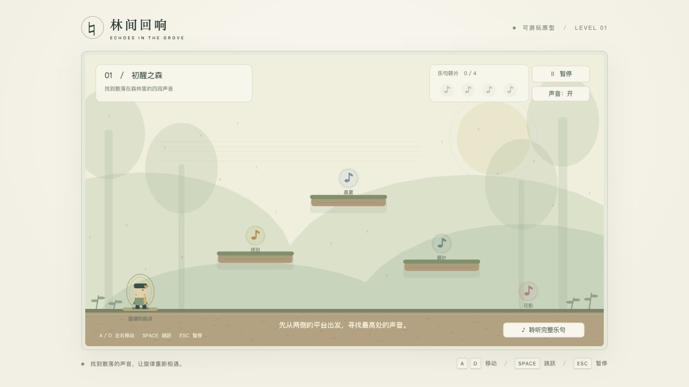
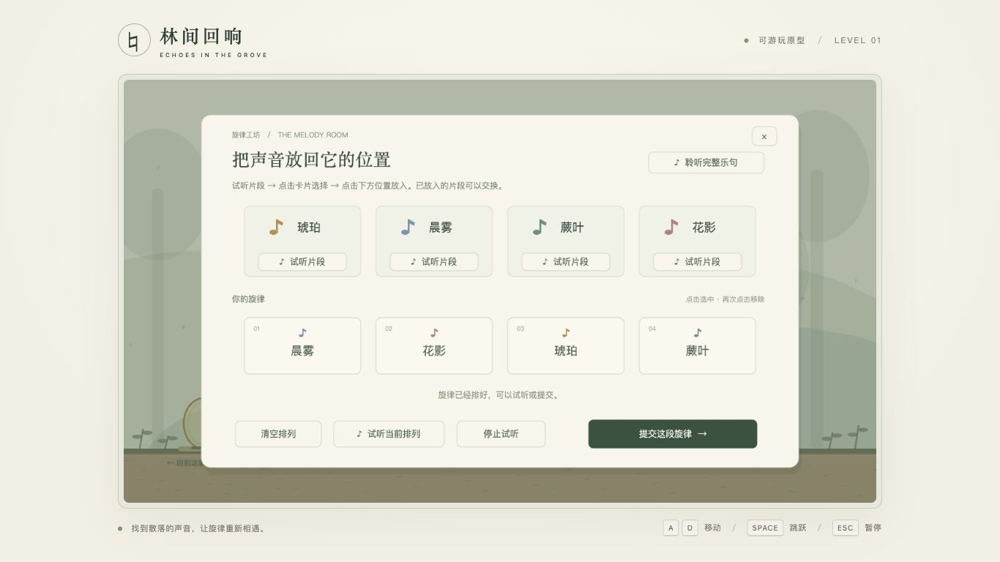

# 瓶中小调春季验收记录

## 2026-10-26 平台路线设计确认

右侧到中央最高平台不可达是明确的关卡设计，取代早期“两侧均可跳上中央”的要求。当前重力 1800、起跳速度 750 保持不变；理论最大跳高 156.25，左侧到中央高差 140 可达，右侧到中央高差 160 不可达。地面到左右平台分别为 140/120，仍可跳上；地面到中央为 280，不能直接跳上。

可达性测试已改为同时保护“左侧可达中央”和“右侧不可达中央”，README、素材说明及策划落地说明同步更新。`pnpm test` 共 25 项全部通过；此前推送时的 24/25 是测试仍沿用旧路线要求造成的预期不符，不是需要放宽右侧跳跃能力的缺陷。下方两侧均可达的记录属于旧物理参数下的历史验收。

## 2026-10-26 玩法注释与音频启用

- 玩法与设定相关函数已补充中文 JSDoc，覆盖场景流程、显现/收集、移动跳跃、音序器、回忆机会、天气恢复、出口、输入与音频。通用文本/绘图/查询工具不堆叠重复注释；关键配置类型补充参数含义。新增 [功能与代码索引](GAMEPLAY_CODE_MAP.md)，README 提供入口。
- 原音频路径直接调用 resume 后继续播放，忽略恢复失败，也没有等待浏览器上下文真正运行。现由原生 HTML 开场按钮直接触发解锁；`BrowserAudioGate` 同时在原生输入事件内请求解锁，并等待 running 后才继续播放。拒绝或超时可重试，旧关卡的异步恢复不能跨关发声。
- 模糊回忆按钮在解锁过程中防重复请求，只有成功开始播放才消耗本轮回忆；背景、音效、完整乐句统一经过 Phaser 主输出。暂停恢复和声音开关也会重试恢复上下文。
- 新增浏览器声音门禁的 7 项回归测试，覆盖原生事件内立即恢复、延迟恢复、拒绝后重试、请求悬挂超时、Promise 完成但状态未运行、关卡销毁取消以及 HTML Audio 回退。连同现有玩法/内容测试共 25 项通过，类型检查与生产构建通过。
- 通过 `.command --no-open` 启动生产构建，在内置 Chromium 浏览器用真实点击验证：开场按钮成功进入游戏；完成四瓶 E 收集后进入排序，模糊回忆成功播放路径消耗一颗点并禁用重复点击；控制台无音频警告或错误。也验证了 Enter 开始、暂停菜单切换声音后继续，取消静音不会提前结束暂停。此检查确认音频上下文正常运行及播放流程，不等同于测量本机扬声器的实际输出。开场截图见 [原生声音启用入口](screenshots/native-audio-start.png)。
- Safari 原生窗口自动化的坐标操作返回 `noWindowsAvailable`，因此本次未完成 Safari 真正点击后的扬声器试听验证，未改动浏览器或系统的静音/自动播放设置。

## 2026-10-26 E 键收集与双击启动

当前版本取消接触和鼠标点击拾取，靠近已显现的玻璃瓶才显示“按 E 收集”。以下旧版本的鼠标/接触拾取记录仅供历史参考。

- 18 项现有规则与内容测试、TypeScript 检查和生产构建通过。启动脚本通过 Bash / Node 语法检查。
- 浏览器真实键鼠验证：未显现时到达瓶子位置并按 E，进度保持 0/4；F 显现后与瓶子重叠仍为 0/4；点击也不收集；离开范围隐藏提示，靠近重新显示。
- 按 E 后只收集目标瓶子，提示消失、计数增加；地面和三个平台的四个瓶子均能收集，返回起点正常打开音序器。错误提交后计数归零、机会递减、瓶子与提示一起复位隐藏。
- macOS 实际通过 Finder 双击 `Start-Game-macOS.command`，默认 Safari 自动打开游戏页面；本地页面与关卡 JSON 均返回 HTTP 200，游戏浏览器控制台无警告/错误。
- 在中文与空格路径的独立测试副本内，删除已有运行时/依赖条件下强制走便携 Node 准备流程：官方包下载及 SHA-256 校验通过，npm exec 安装固定 pnpm 并准备依赖，构建及启动成功。4173 被占用时自动使用 4174，Ctrl+C 正常退出。测试副本和测试服务已清理。
- Windows 入口按 PowerShell 5.1 与系统批处理编写，静态检查了路径引用、x64/ARM64 选择、校验和、依赖准备和退出码传递；当前环境为 macOS，**尚未在 Windows 真机执行**。

当前画面见 [按 E 收集提示](screenshots/press-e-to-collect.png)，启动方式见 [双击启动说明](LAUNCHER.md)。

## 2026-10-26 声音罐位置简化

已按最新要求移除春风、雨云、嫩芽、鸟巢四类来源图形及场景标签，仅保留 F 显现后的声音罐。透明点击区跟随罐子的显现、收集和复位状态启闭。类型检查与生产构建通过，浏览器已验证四个罐子正常显现，并在未触碰罐子时通过鼠标点击完成收集，进度从 0/4 变为 1/4。

当前场景见 [移除来源元素后的画面](screenshots/jars-without-source-elements.png)。下方早期截图保留为变更前的验收历史。

## 2026-10-26 当前版本

项目实际目录为 `/Users/wanna/game/gamejam261024`；已确认 Git 根目录为新位置，原提交 `11e0755` 与远程关联均保留。旧目录是兼容符号链接，Word 策划案仍为原有只读文件。

### 自动检查

- `pnpm test`：18 项全部通过，包括 F 前禁止拾取、每轮仅一次提示、听后答错不重复扣点、未听答错也扣点、三次失败与重新开始、所有 24 种排列、固定 BPM、配置校验、三平台可达性及音频逐样本检查。
- `pnpm build`：严格类型检查和 Vite 生产构建通过。
- 开场、模糊回忆、恢复演出使用独立音频键；自动检查确认模糊文件与清晰文件 PCM 不同。四只声音罐按正确顺序拼接与清晰主题一致。
- `bash -n scripts/dev.sh` 与 `git diff --check` 通过。已从新目录实际启动开发与生产预览服务器。

### 浏览器实际操作

测试环境为 macOS 的 Codex 内置浏览器，PC 1280×720 视口。使用真实键盘按住与鼠标点击/拖拽完成，没有修改游戏内部状态跳过收集或答题。

| 验证项目 | 结果 |
| --- | --- |
| 初始只见自然互动对象，音符/罐子隐藏且不可拾取 | 通过；未按 F 时移动到鸟巢并按 E，进度保持 0/4 |
| 方向键与 A/D、空格保留可用 | 通过 |
| 按一次 F 显现所有本轮音符 | 通过 |
| 全部声音收集后返回出生点进入音序器 | 通过，多轮实际重复收集 |
| 拖动卡片放入、拖动已有槽位交换 | 通过；修复了已有交互区未设置 dropZone 的问题后复测 |
| 点击排序、槽位状态与按拍演奏 | 通过 |
| 回忆一次后立即空一颗点，第二次点击无效 | 通过 |
| 关闭面板、暂停再返回不会刷新本轮额度 | 通过 |
| 未听就答错，3 点变 2 点 | 通过 |
| 听过再答错，不额外重复扣点 | 通过 |
| 答错后清空收集、排列，所有音符复位并隐藏 | 通过；重新按 F 后才开始下一次收集 |
| 三次错误依次结束所有机会 | 通过，出现失败重开界面 |
| 失败后重开 | 通过，初始再次为三个实心点、0/4、隐藏音符 |
| 正确排列 | 通过，触发恢复主题、冰层消融与花草开放 |
| 真实出口阻挡解除、走向右侧下一季入口 | 通过，到达后显示完成界面 |
| 最终生产构建 | 再次实际完成显现、收集、拖拽排列、正确还原与出口通关 |

当前范围为春季完整可玩切片。夏秋冬为内容方向与接口占位；正式图像、自然录音与混音仍由后续素材替换接入。

### 当前版本截图

- [初始隐藏状态](screenshots/spring-hidden.png)
- [答题界面与回忆圆点](screenshots/spring-arrangement.png)
- [失败后复位隐藏](screenshots/spring-retry.png)
- [三次失败重开界面](screenshots/spring-failed.png)
- [春季恢复与开路](screenshots/spring-restored.png)
- [走到出口完成](screenshots/spring-completed.png)

以下保留最初原型的验收历史，旧截图和规则不代表当前版本。

## 2026-10-25 初始原型历史记录

日期：2026-10-25。环境：macOS，Codex 内置浏览器；Node.js 24.19.0、pnpm 11.25.0。

### 自动检查

- `pnpm test`：10 项测试全部通过。覆盖重复拾取、未知片段、未集齐/未返回时禁止通关、答错重试、退出后保留进度、槽位交换/移除/清空、所有 24 种片段排列、无效配置、素材引用和跳跃可达性。
- 临时 WAV 检查：按正确答案拼接四段的 PCM 数据，与完整乐句逐样本一致，并包含实际声音。
- `pnpm build`：严格 TypeScript 检查与 Vite 生产构建通过，产物位于 `dist/`。
- `bash -n scripts/dev.sh`：脚本语法检查通过；系统 PATH 没有 Node/pnpm 时，已实际通过该脚本调用 Codex 附带运行时启动开发服务器。
- 构建预览中的首页、关卡 JSON 和整句 WAV 均返回 HTTP 200。

### 浏览器实际操作

开发版和生产构建版均使用真实鼠标点击与键盘按住操作验收，没有通过修改内部状态跳过收集或答题。

| 项目 | 结果 |
| --- | --- |
| 开始游戏后从左侧地面出生，初始进度 0/4 | 通过 |
| A/D 移动、空格跳跃、角色朝向与落地 | 通过 |
| 地面可分别跳到左、右平台 | 通过 |
| 左、右平台均可跳到最高平台（早期参数下的旧设计） | 当时通过；当前以“左侧可达、右侧不可达”为准 |
| 站在最高平台正下方，地面跳跃无法直达 | 通过 |
| 三个平台和地面各有一段，拾取后消失且进度累加 | 通过 |
| 集齐后提示返回左侧起点，进入起点打开排序 | 通过 |
| 未放满时提交和排列试听按钮禁用 | 通过 |
| 错误排列显示反馈，保留已有片段与顺序 | 通过 |
| 退出排序、离开再返回，恢复先前排列 | 通过 |
| 点击片段试听、连续试听当前排列与槽位高亮 | 通过，浏览器无音频报错 |
| 通过点击已有槽位交换，修正排列后通关 | 通过 |
| 通关显示完成面板，重新开始后进度归零 | 通过 |
| Esc 暂停/继续、暂停菜单重开 | 通过 |
| 静音后重开，声音状态与按钮文案一致 | 通过 |
| 1366×768 PC 窗口完整显示画面和操作区 | 通过；游戏外框底部约 695 px，位于视口内 |
| 最终生产构建浏览器 error/warn 日志 | 无 |

本阶段验证范围为 PC 键鼠与上述浏览器。手柄和触屏保留输入接口，尚未作为本 Demo 的设备支持交付。正式美术、正式音乐以及不同浏览器的音频衔接，需要在素材接入后继续验收。

### 截图

第一关布局：

旋律排列界面：

最终生产构建通关记录：

